  

  
  
  
  
  
  
  

### 👋 About me

I'm a **full-stack software engineer in Islamabad, Pakistan**. I build web, desktop and AI software, with a speciality in **CAD, BIM and 3D file formats** for the construction industry.

- 🏗️ **Technical Lead, Software Department** at Sysol Limited: engineering software for light-gauge steel detailers and estimators who work for builders in Australia and New Zealand
- 🏭 **Software Developer (contract)** at Scottsdale Construction Systems: ScotFab, the production dashboard for Scottsdale Steel Frames
- 🚀 **Co-founder** of [XechTech](https://xechtech.com): point-of-sale systems and apps for businesses in Pakistan

### 🧰 Tech I work with

   
   
  

Also: **SQL Server** · **Entity Framework** · **PySide6 / Qt** · **SketchUp, IFC, DXF, glTF** · **LLM integration and MCP servers**

### 🔧 Open source

<table>
<tr>
<td width="50%" valign="top">

**[OpenSKP](https://github.com/iamahsanmehmood/openskp)** 
Read, write and convert SketchUp (.skp) files without the SketchUp SDK, in Python, TypeScript, C#, Dart and C++. Exports glTF, OBJ, STL, DXF, IFC4 and Fragments.

 📺 Featured by Blender 3D Architect: <a href="https://www.youtube.com/watch?v=q-Gjsa4tuPU">Blender and FreeCAD can now read and write SketchUp files</a> · <a href="https://www.youtube.com/watch?v=M43s__dC3FM">Blender 5.3 SketchUp import</a>

</td>
<td width="50%" valign="top">

**[NVR Cast Hub](https://github.com/iamahsanmehmood/nvr-cast-hub)** 
Cast your desktop, a browser tab or YouTube to any CCTV monitor. Your PC pretends to be an IP camera, so the recorder shows whatever you cast, with sound.

</td>
</tr>
<tr>
<td width="50%" valign="top">

**[SAIE](https://github.com/iamahsanmehmood/saie)** 
An MCP server with 67+ tools that lets AI agents (Claude, Cursor, Ollama) build and inspect models in a live SketchUp session.

</td>
<td width="50%" valign="top">

**[urdu-tools](https://github.com/iamahsanmehmood/urdu-tools)** 
Zero-dependency Urdu text processing for TypeScript, C# and Dart: normalisation, search, sorting, numbers to words and compound words. 850+ tests.

</td>
</tr>
</table>

Also: [Blender](https://github.com/iamahsanmehmood/blender-openskp) and [FreeCAD](https://github.com/iamahsanmehmood/freecad-openskp) add-ons for .skp import and export · [inpage-format](https://github.com/iamahsanmehmood/inpage-format), a reverse-engineered spec for InPage Urdu files

### ✍️ Latest writing

<!-- BLOG-POST-LIST:START -->
- [I turned the CCTV monitor on the wall into a screen I can cast to](https://dev.to/iamahsanmehmood/i-turned-the-cctv-monitor-on-the-wall-into-a-screen-i-can-cast-to-kfk)
- [We Let AI Build SketchUp Models With Nothing But an API](https://dev.to/iamahsanmehmood/we-let-ai-build-sketchup-models-with-nothing-but-an-api-3d0a)
- [OpenSKP 1.1.0: A Native .skp Writer, Now in All Five Languages](https://dev.to/iamahsanmehmood/openskp-110-a-native-skp-writer-now-in-all-five-languages-5d0m)
- [Why We Built OpenSKP](https://dev.to/iamahsanmehmood/why-we-built-openskp-4g8d)
- [How We Reverse-Engineered the SketchUp &lpar;.skp&rpar; Binary Format to Build a Pure JS/Python 3D Viewer](https://dev.to/iamahsanmehmood/how-we-reverse-engineered-the-sketchup-skp-binary-format-to-build-a-pure-jspython-3d-viewer-4nm2)
<!-- BLOG-POST-LIST:END -->

### 📊 GitHub activity

  
  

<picture>
  <source media="(prefers-color-scheme: dark)" srcset="https://raw.githubusercontent.com/iamahsanmehmood/iamahsanmehmood/output/github-snake-dark.svg">
  <source media="(prefers-color-scheme: light)" srcset="https://raw.githubusercontent.com/iamahsanmehmood/iamahsanmehmood/output/github-snake.svg">
  
</picture>

Outside work I run (half marathon finisher, with Islamabad's "Run With Us" group) and read about philosophy and history.
